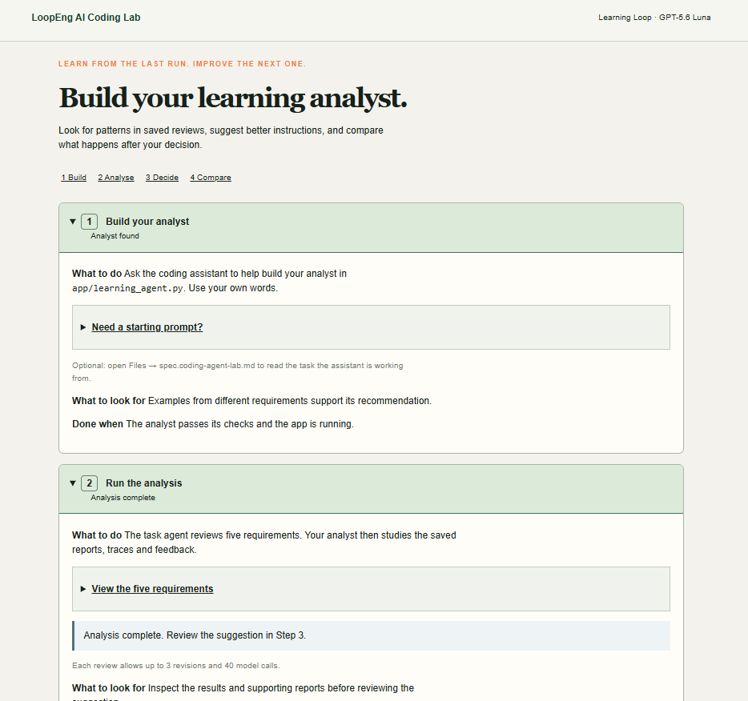

# LoopEng AI Coding Lab — Learning Loop

Build the analyst that studies five requirement reviews and suggests better task-agent instructions. The app handles fetching, report writing, verification, saving and automatic evaluation after your decision. Open App Preview for the four activity cards. Optional starting prompts are in the course instructions.

The five requirements are Avatar Upload, Password Reset, Notifications, Team Invitations and Report Export. View them in Step 2. First-draft quality uses each report’s first draft, before the agent revises it. Keep or reject is a valid decision; a weak unchanged baseline does not earn improvement credit through random variation. Save your own decision and outcome explanations. Use your own prompts and supported ideas; Live results can differ. Default review limits are 3 revisions and 40 model calls, separate from course submission attempts.

## Maintainer commands

Use Python 3.11+. Create `.venv`, install requirements.txt, then run `.venv/bin/python -m pytest -q tests/test_capstone.py tests/test_capstone_evidence.py tests/test_capstone_checkpoint.py tests/test_diagnostics.py tests/test_repairs.py tests/test_report_view.py tests/test_verification_exercise.py`.

Start/stop/status: `.venv/bin/python scripts/server.py start` (or stop/status). Port 4000; runtime logs under .runtime. APP_DATA is persistent activity; never reset it to repair code. Revisions are feedback-driven edits, turns are model calls, and course submissions are separate attempts.

The local test suites use controlled responses and temporary workspaces. They do not establish hosted proxy or persistence behavior. The shipped learning_agent.py is intentionally unfinished. Existing extra fixtures support internal regressions only.
